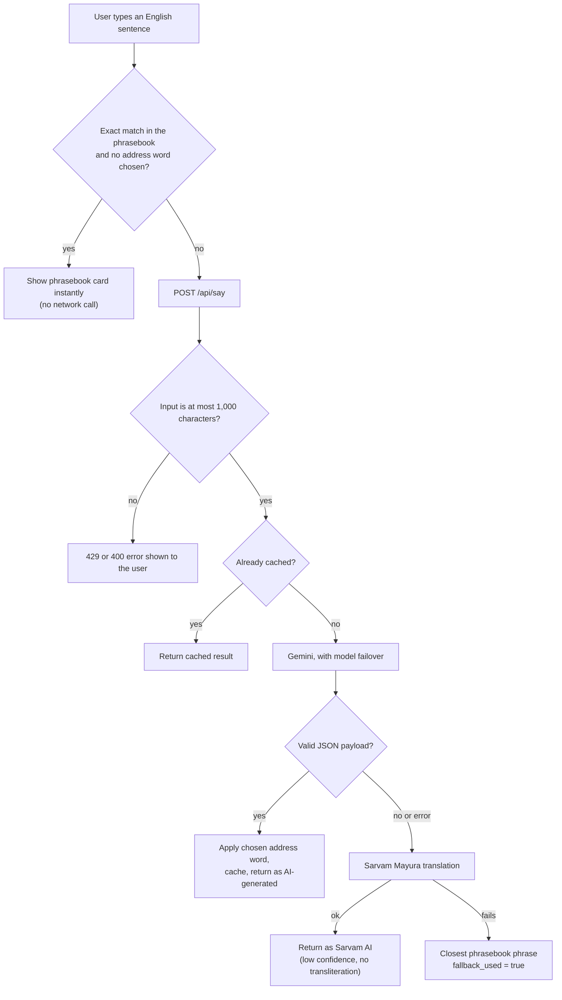
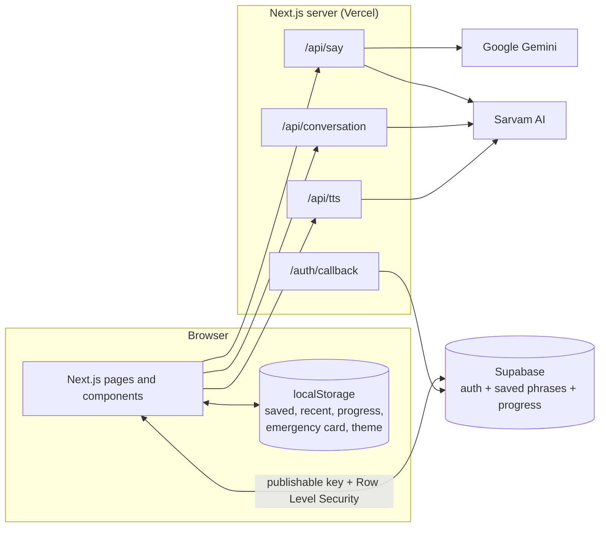

# Kannada Companion

**Get through your day in Kannada, and learn while doing it.**

Kannada Companion is a mobile-friendly web app for people who have just moved to, or are visiting, Karnataka. Instead of a fixed course, it starts from the moment you are in (an auto ride, a vegetable market, a pharmacy counter) and gives you the words for it: Kannada script, easy-to-read transliteration, natural audio, and what the other person is likely to say back. The phrases you actually use are saved so you can practise them later.

Built for the **Kannada Digital Innovation Hackathon 2026** (HackerRank Campus Crew, The National Institute of Engineering, Mysuru). Theme: *Code. Create. Celebrate Kannada.* Track 03: **Kannada in Everyday Life**.

| | |
|---|---|
| Live demo | [kannada-companion on Vercel](https://kannada-companion-f61feqyyz-ishitgsigmas-projects.vercel.app/) |
| Demo video | `<your video link>` |
| Source | [github.com/ishitGsigma/kannada-companion](https://github.com/ishitGsigma/kannada-companion) |

<!-- Add screenshots to docs/screenshots/ and uncomment:


-->

---

## Table of contents

1. [Why this exists](#why-this-exists)
2. [Features](#features)
3. [How Say It works](#how-say-it-works)
4. [Architecture and tech stack](#architecture-and-tech-stack)
5. [The phrase bank](#the-phrase-bank)
6. [Getting started](#getting-started)
7. [API reference](#api-reference)
8. [Data and storage](#data-and-storage)
9. [Security and privacy](#security-and-privacy)
10. [Accessibility and usability](#accessibility-and-usability)
11. [Testing](#testing)
12. [Known limitations](#known-limitations)

---

## Why this exists

Lesson-style Kannada apps teach vocabulary on a fixed curriculum. Newcomers, however, need help at specific, stressful moments, and they need it immediately: telling an auto driver where to go, understanding a price, explaining a symptom to a pharmacist. A general translator gives a result but no sense of how much to trust it, no politeness guidance, and no path from "I needed this once" to "I know this now".

Kannada Companion is built around one loop:

**Need → Help → Reuse → Learn**

1. **Need:** pick a situation or type what you want to say.
2. **Help:** get a usable Kannada phrase right away, with audio and a full-screen mode to show the other person.
3. **Reuse:** save the phrases that worked.
4. **Learn:** review your saved phrases as flashcards until you no longer need the app for them.

### Background

The need is visible in current news from Karnataka:

- Auto drivers and passengers describe misunderstandings and arguments that stem from a language barrier. See [The South First](https://thesouthfirst.com/news/language-wars-bengalurus-auto-drivers-non-local-techies-and-a-kannada-lesson/).
- Bengaluru's civic body sent notices to more than 50,000 shops over the rule that Kannada must take 60% of signboard space, so signs are increasingly written in Kannada. See [The South First](https://thesouthfirst.com/karnataka/deadline-to-allot-60-space-to-kannada-on-signboards-ends-on-wednesday-bbmp-issues-notices-to-over-50000-shops).
- The Kannada Language Development Authority has proposed that prescriptions in government hospitals be written in Kannada. See [The South First](https://thesouthfirst.com/health/in-karnataka-language-push-reaches-government-hospitals-klda-proposes-prescriptions-to-be-written-in-kannada).
- People already improvise with AI tools to get through these moments. See [The Week](https://www.theweek.in/wire-updates/national/2025/04/29/mes17-ka-techie-ai-language.html).

### Design principles

- **Situation first, course second.** Content is organised by where you are, not by grammar topic.
- **Trust is visible.** Every answer carries a label that says where it came from. Nothing is presented as verified unless a native speaker has checked it.
- **Honest failure.** If the AI is unavailable, the app says so and shows the closest phrasebook entry. It never pretends that entry is a translation of your sentence.
- **You choose, the app doesn't guess.** Address words (*anna*, *akka*, *sir*, *madam*) are selected by the user. Age and gender are never inferred.
- **Private by default.** Guest mode works without an account. The emergency card never leaves the device.
- **Cost-aware, not quota-proof.** Exact phrasebook matches avoid AI calls, and successful translations are cached in-process. Sequential fallback requests can still use provider quota while recovering from model errors.

---

## Features

### Phrase packs
Six packs, 18 scenarios and 359 phrases covering transportation, shopping, healthcare, travelling, education and workplaces. Each phrase card shows:

- Kannada script
- Transliteration in simple English letters
- English meaning
- A status label (see [trust labels](#trust-labels))
- **Play** (natural Kannada audio), **Show** (full-screen large text for the other person), **Copy** and **Save**
- Optional cultural tip and "They may reply" entries with their own audio

The home page has a search box that looks across every phrase and scenario, plus filter chips (All, Travel, Shopping, Healthcare, Work and study). Each pack page has jump links to its scenarios.

### Say It (translate for the moment)
Type a sentence in English, choose who you are speaking to (auto driver, shopkeeper, doctor or pharmacist, colleague, boss or senior, stranger) and a speaking style (polite or casual). Optionally add an address word. The result is a Kannada phrase with transliteration, audio, a cultural tip and a likely reply. `Ctrl+Enter` (or `Cmd+Enter`) submits.

### Conversation bridge
Understanding the reply is the hard part for newcomers, so Say It continues as a two-sided thread:

- Tap **Use reply** on a suggested reply to add it to the conversation, or
- Type the Kannada you heard and get the English meaning, then type your next response and translate it.

The thread alternates between **You say** and **They say** turns, and each turn is a normal phrase card.

### Address words
Choose *Anna*, *Akka*, *Sir* or *Madam* yourself. The word is added in front of the Kannada and transliteration, and a short note explains the choice. For example, with *Anna* selected, the phrase becomes `ಅಣ್ಣ, ಇದರ ಬೆಲೆ ಎಷ್ಟು?`. The app notes that relationships and preferences vary.

### Natural Kannada audio
Audio is generated with Sarvam AI text-to-speech. If that is unavailable, the app falls back to the browser's own speech voice (it prefers a Kannada voice, then Hindi, then the default). Each Sarvam playback can use provider quota; the TTS route does not currently cache audio.

### My Kannada (reuse and learn)
- Save any phrase with one tap, including AI-generated ones.
- Browse your saved phrasebook, filter by status, and review as flashcards.
- Mark phrases **Known** or **Review**; the review queue holds only the ones you flagged.
- A study streak counts consecutive days you practised.
- "Recently used" shows your last phrases on the Say It page.

### Hear numbers
A listening trainer for the numbers you meet when shopping and travelling. In **Prices** mode you hear an amount in rupees; in **Numbers** mode you hear a number word. You pick the digits and get instant feedback with the Kannada and transliteration, plus a running score.

### Emergency card
Enter your name in English and Kannada, blood group, allergies, medicines, an emergency contact, phone number and address. The app builds a bilingual card you can show or print (Print / Save PDF). The card is stored **only in this browser on this device** and is never uploaded.

### Optional account and sync
Sign in with a passwordless email link (Supabase) to sync saved phrases and learning progress across devices. Guest data on the device is merged into the account on first sign-in. Signing out keeps guest data on the device. Conversation text is never synced.

### Interface
Responsive layout with a bottom navigation bar on phones and a top bar on larger screens, a light and dark theme that remembers your choice, and loading, empty and error states for every flow.

---

## How Say It works

Say It is designed so the user always gets something useful and always knows how far to trust it.



### Layers

1. **Phrasebook match (client).** If the sentence exactly matches a phrase in the bank (ignoring case and punctuation) and no address word is selected, the stored phrase is shown with no network call.
2. **Gemini.** The server sends the sentence, listener and tone with a system prompt that asks for natural *spoken* Kannada, simple phonetic transliteration, a likely reply, a cultural tip and a confidence value, returned as JSON at low temperature. If the first model returns 404, 429 or a 5xx error, the next model in the list is tried (up to five).
3. **Validation.** The response must contain a Kannada phrase, a transliteration and a `high` or `low` confidence, and any likely reply must be complete. Invalid output is rejected.
4. **Sarvam Mayura.** If Gemini is unavailable or its output is invalid, the sentence is translated with Sarvam's translation model (colloquial mode for the casual style, formal otherwise). This result has no transliteration and is always marked low confidence.
5. **Phrasebook fallback.** If both fail, the closest phrase from the bank is returned and flagged `fallback_used`. The interface explicitly says it is *not* a translation of what the user typed.

### Trust labels

| Label | Meaning |
|---|---|
| **Verified** | A phrasebook entry marked `verified: true` after native-speaker review. *None are marked yet.* |
| **Needs review** / **Phrase bank** | A phrasebook entry that has not been reviewed yet |
| **AI-generated** | Gemini output that passed validation. Not verified |
| **Sarvam AI** | Sarvam translation. No transliteration, low confidence |
| **Phrasebook suggestion** | Closest stored phrase, shown because the AI was unavailable. Not a translation of the user's sentence |
| **Likely reply** / **Heard reply** | Conversation turns: a suggested reply, or the user's typed Kannada with its English meaning |

---

## Architecture and tech stack



AI keys live only on the server. The browser talks to Supabase directly using a publishable key, and Row Level Security restricts every row to its owner.

| Layer | Technology |
|---|---|
| Framework | Next.js (App Router) and React |
| Styling | Hand-written CSS with light and dark themes, Noto Sans Kannada and DM Sans fonts |
| Translation | Google Gemini (primary), Sarvam Mayura (backup and Kannada-to-English) |
| Text to speech | Sarvam AI, with browser speech as fallback |
| Accounts and sync | Supabase Auth (email link) and Postgres with Row Level Security |
| Local data | Browser `localStorage`, scoped per signed-in user |
| Tests | Node's built-in test runner |
| Hosting | Vercel |

---

## The phrase bank

The content lives in one file, [`lib/packs.js`](lib/packs.js), and drives every screen.

| Pack | Scenarios | Phrases |
|---|---|---|
| Transportation | Taking an auto · City bus and metro · Asking for directions | 59 |
| Shopping | Market and bargaining · Groceries and quantities · Clothes and accessories | 60 |
| Healthcare | Describing symptoms · At the clinic · Pharmacy | 60 |
| Travelling | Sightseeing · Hotel and accommodation · Restaurants and food | 60 |
| Education | Classroom basics · Campus and facilities · Exams and assignments | 60 |
| Workplaces | Office basics · Meetings and communication · Tasks and workplace needs | 60 |
| **Total** | **18 scenarios** | **359** |

### Phrase format

```js
p('Please use the meter', 'ಮೀಟರ್ ಹಾಕಿ', 'meetar haaki', {
  verified: false,                       // set true ONLY after native-speaker review
  tip: 'Add "sir" or "anna" to sound polite.',
  replies: [
    { kn: 'ಮೀಟರ್ ಇಲ್ಲ', translit: 'meetar illa', en: 'No meter (fixed price)' },
  ],
}),
```

`p(en, kn, translit, extra)` is a small helper at the top of the file. Everything after the third argument is optional.

### Adding content

- **A phrase:** add a `p(...)` line inside a scenario's `phrases` array.
- **A scenario:** add `{ id, title, phrases: [...] }` to a pack's `scenarios`.
- **A pack:** add an object with `id`, `icon`, `title`, `blurb` and `scenarios` to `PACKS`. The home tile and the `/pack/[id]` page appear automatically.

Saved phrases and learning progress are keyed by the Kannada text, so keep each Kannada string unique where you can.

### Transliteration style
One simple phonetic scheme throughout: long vowels doubled (`aa`, `ee`, `oo`), no diacritics, and words separated as they are spoken. Keep this consistent when adding phrases.

### Verification workflow
1. Export the phrases for a pack and give them to a native Kannada speaker.
2. For each phrase they mark it *natural*, *bookish* (correct but not how people speak) or *wrong*, with their preferred wording.
3. Apply the corrections in `lib/packs.js`.
4. Set `verified: true` only for phrases they approved.

---

## Getting started

Requirements: Node.js 18.17 or newer and npm.

1. Install dependencies with `npm install`.
2. Copy `.env.example` to `.env.local` and fill in the provider values you want to use. Never commit `.env.local`.
3. Run `npm run dev` and open `http://localhost:3000` (or use the port printed by Next.js if 3000 is occupied).
4. For Supabase sync, run [`supabase/schema.sql`](supabase/schema.sql), configure the Auth Site URL and `/auth/callback` redirect, then restart after changing env values.

### Getting keys

- **Gemini:** create a key at Google AI Studio. A free tier exists, with rate limits that change, so check your project's current limits there.
- **Sarvam AI:** create a key in the Sarvam dashboard. New accounts receive free credits; check your dashboard for the current amount.
- **Supabase:** create a project and copy the project URL and publishable key from Project Settings, then API.

### How sync behaves
- On sign-in, local and cloud data are merged, and guest data on the device is migrated once per account.
- Unsaving a phrase deletes it from the cloud instead of restoring it on the next sync.
- Changes sync shortly after you save, unsave or mark a phrase, and the account page has a **Sync now** button and a status message.
- A signed-in user's local data is stored under a user-specific key, so guests and accounts never mix on a shared device.

---

## API reference

Routes accept and return JSON, except `/api/tts`, which returns audio. The app enforces input-length checks but does **not** currently have a distributed per-IP rate limiter; upstream Gemini and Sarvam quotas still apply. Add a shared rate limiter at the hosting layer before public production use.

### `POST /api/say`
Translate an English sentence into spoken Kannada.

**Request**
```json
{ "text": "Does this bus go to Majestic?", "context": "stranger", "tone": "polite", "address": "none" }
```

| Field | Values |
|---|---|
| `text` | Required, up to 1,000 characters |
| `context` | `auto driver`, `shopkeeper`, `doctor / pharmacist`, `colleague`, `boss / senior`, `stranger` |
| `tone` | `polite` or `casual` |
| `address` | `none`, `anna`, `akka`, `sir` or `madam` |

**Response (200)**
```json
{
  "kannada_script": "ಈ ಬಸ್ ಮೆಜೆಸ್ಟಿಕ್‌ಗೆ ಹೋಗುತ್ತಾ?",
  "transliteration": "ee bus Majestic ge hogutta?",
  "likely_reply": { "kn": "...", "translit": "...", "en": "..." },
  "cultural_tip": "...",
  "confidence": "high"
}
```
Sarvam results add `"provider": "sarvam"`. Phrasebook fallbacks add `"fallback_used": true`. The route returns `200` with a phrasebook fallback even if translation fails, so the interface always has something to show.

**Errors:** `400` empty or over 1,000 characters, `500` neither AI provider key is configured. Provider failures generally fall back to another provider or a phrasebook suggestion.

### `POST /api/conversation`
Translate a Kannada reply that the user heard into English.

**Request:** `{ "text": "ನೂರು ರೂಪಾಯಿ" }` (up to 1,000 characters)
**Response (200):** `{ "english": "100 rupees" }`
**Errors:** `400` empty or too long, `429`, `502` empty or failed translation, `503` Sarvam not configured.

### `POST /api/tts`
Generate Kannada speech.

**Request:** `{ "text": "ಮೀಟರ್ ಹಾಕಿ" }` (up to 1,000 characters)
**Response (200):** `audio/wav`
**Errors:** `400` empty or over 1,000 characters, `500` Sarvam failure, `503` Sarvam not configured. The browser then falls back to its own voice.

### `GET /auth/callback`
Completes the email sign-in by exchanging the `code` query parameter for a session, then redirects to `/account` (or to `/account?auth_error=...` on failure).

### Request limits

`/api/say`, `/api/conversation`, and `/api/tts` reject inputs over 1,000 characters. There is no app-level rate limiter yet. A serverless deployment needs a shared rate limiter or host-level protection; in-memory counters would not provide a reliable limit across instances.

---

## Data and storage

### Browser storage (`localStorage`)

| Key | Contents |
|---|---|
| `kc_saved` | Saved phrases |
| `kc_saved_deleted` | Phrases unsaved locally, so sync can delete them in the cloud |
| `kc_recent` | Last 8 phrases used in Say It |
| `kc_learning` | Known / review status per phrase |
| `kc_study_days` | Dates you practised (last 45) |
| `kc_emergency_card` | Emergency card details (never synced) |
| `kc_theme` | `light` or `dark` |

When signed in, the first five are stored under a key suffixed with the user id.

### Database tables

| Table | Columns |
|---|---|
| `saved_phrases` | `user_id`, `phrase_key`, `phrase` (JSON), `created_at`. Primary key `(user_id, phrase_key)` |
| `learning_progress` | `user_id`, `phrase_key`, `status` (`known` or `review`), `updated_at`. Primary key `(user_id, phrase_key)` |

Both tables reference `auth.users` with `on delete cascade`, so deleting a user removes their data.

---

## Security and privacy

**Secrets**
- AI keys are read only in server routes. None use the `NEXT_PUBLIC_` prefix.
- `.env.local` and other `.env*` files are git-ignored; only `.env.example` (placeholders) is committed.
- The Supabase publishable key is designed to be public. Never use a Supabase service-role or secret key in this app.

**Abuse and cost control**
- A 1,000-character input cap on translation, reply interpretation, and TTS routes.
- Gemini translation results are cached in-process; this cache is not shared across serverless instances. TTS is not cached by the API route.
- Gemini and Sarvam translation calls have timeouts and provider failover. Provider quotas still apply.
- There is no distributed per-visitor rate limiter yet; add one before public production use to protect provider credits.

**Data protection**
- Row Level Security on every table: a user can only read and write rows where `user_id` equals their own id.
- The emergency card and conversation text are never uploaded to Supabase.

**Dependencies**
- The current project uses Next.js 14 and React 18. `npm audit` has reported high/critical advisories in Next.js and PostCSS; the suggested automatic fix requires a major Next.js upgrade. Review and upgrade these dependencies before treating the deployment as production-ready. Re-run `npm audit` before each release.

**What is sent to third parties.** Sentences typed into Say It, Kannada text for reply interpretation, and phrases played as audio are sent to Google (Gemini) and Sarvam AI to produce results. Free-tier terms for AI providers may allow them to use submitted content to improve their models. Do not type personal or sensitive information into Say It. The app does not collect photos or microphone audio.

**Medical notice.** Healthcare phrases are communication aids, not medical advice. In an emergency call **108**.

---

## Accessibility and usability

- Semantic buttons, links and form labels throughout, with `aria-label`s on icon-only controls.
- Status and error messages use `role="status"` or `role="alert"`; AI results are announced with `aria-live`.
- Full-screen **Show** mode displays large high-contrast text for the other person, dismissed with a tap.
- Light and dark themes, chosen by the user and remembered.
- Keyboard shortcut `Ctrl/Cmd + Enter` on the Say It form.
- Every screen has loading, empty and error states.
- Transliteration is provided because many users cannot read Kannada script yet.

---

## Testing

```bash
npm test
```

13 automated tests cover:

- **Address words:** opt-in prefixing, and no duplicate when the word is already present.
- **Storage:** recent phrases in newest-first order, stable saved list, learning status, study streaks, isolation between signed-in and guest storage, and the emergency card.
- **Sync:** an unsaved cloud phrase is deleted instead of being restored.
- **Translation quality:** fallback phrase selection (including preferring the concise phrase on ties) and rejection of invalid AI payloads.

Before releasing, also run `npm run build` and test Say It, audio and sign-in by hand on a phone.

---

## Known limitations

- **No camera or OCR.** Reading signs, menus and medicine labels is not implemented.
- **AI can be wrong.** Translations may be unnatural or incorrect. Check important phrases with a local, especially in healthcare.
- **Sarvam fallback has no transliteration**, because the service returns script only.
- **Audio depends on Sarvam credits.** If credits run out or the key is missing, the browser voice is used and may lack Kannada on some devices.
